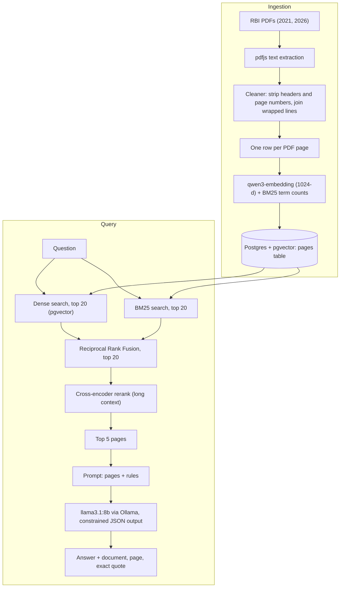

# RBI Digital Payment Security — RAG Compliance Assistant

A retrieval-augmented question-answering system over two RBI Master Directions on Digital Payment Security Controls: the **2021 Directions** (superseded) and the **2026 Directions** (in force). Every answer is returned as structured JSON that cites the **document, page and an exact quote**, so a compliance officer can check it against the source.

The LLM runs locally (`llama3.1:8b` on an 8GB GPU through Ollama). Chunking, BM25, rank fusion and prompt construction are written by hand in Node.js, with no LangChain. The project also includes an evaluation harness and a 50-question hand-built test set.

> Academic / portfolio project. It is not legal advice, and the source documents are public RBI publications.

## Why this is harder than it looks

Regulatory text has three traps that plain semantic search handles badly:

- **Superseded versions.** The 2021 text is still in the corpus, and answers must come from the current document unless the question asks about the earlier one.
- **Requirements spread across clauses and pages.** One answer can need several paragraphs, and a sentence can start on one page and finish on the next.
- **Formal wording.** Users ask "can the app refuse to install on a jailbroken phone?" and the text says "the bank may explore the feasibility of implementing a code that checks if the device is rooted / jailbroken".

## Architecture



## Tech stack

| Layer | Choice |
|---|---|
| Backend | Node.js / Express |
| Frontend | React |
| Database | PostgreSQL + pgvector (relational data and vectors in one store) |
| Generation | `llama3.1:8b` (Q4_K_M) via Ollama, temperature 0, JSON-schema-constrained output |
| Embeddings | `qwen3-embedding:0.6b` via Ollama (1024 dimensions) |
| Lexical search | BM25 implemented from scratch, term counts stored at ingestion |
| Fusion | Reciprocal Rank Fusion, hand-written |
| Reranker | Long-context cross-encoder run in Node through transformers.js (ONNX) |
| Evaluation | Node (retrieval and citation checks) and Python (RAGAS faithfulness, LLM-judge correctness, analysis) |

## Key design decisions

- **One chunk per PDF page.** My first version split by chapter, section and clause. It was complicated and silently dropped text (see the engineering notes). A page is also the unit that gold labels, citations and quote checks all share. The cost is that retrieval and the reranker must handle long inputs.
- **Hybrid retrieval.** Dense and BM25 candidates are fused with RRF. Per-query diagnostics showed dense is the stronger retriever on paraphrased questions, and BM25 recovers a few queries that dense ranks just past the cutoff.
- **Long-context reranking.** The first cross-encoder read only about 512 tokens per page and missed answers that sat low on a page. A long-context reranker fixed that.
- **Constrained, evidence-first output.** The model must output `status`, then `evidence` (document, page, quote), then `answer`, so it commits to quotes before writing.
- **The page is taken from the quote.** Small models mislabel page numbers, so the scorer resolves each citation's page from where its quote actually appears.

## Evaluation

All numbers are from a **50-question hand-built set** (gold pages written by me) over the two documents.

| Category | n | Recall@5 | MRR | Judged correct | RAGAS faithfulness |
|---|---|---|---|---|---|
| Cross-document comparative | 20 | 0.95 | 0.800 | 18/20 | 0.925 |
| Single-document factual | 10 | 0.95 | 1.000 | 9/10 | 0.783 |
| Multi-clause spanning | 10 | 0.95 | 0.750 | 6/10 | 0.583 |
| Vocabulary mismatch | 10 | 0.70 | 0.492 | 6/10 | 0.768 |
| **All** | 50 | **0.90** | **0.768** | **39/50** | **0.797** |

Recall@5 is the average share of gold pages found in the 5 pages sent to the model. "Judged correct" is the verdict of an LLM judge (Gemini 3.5 Flash Lite) using a fixed rubric.

### Retrieval ablation (top 5)

| Configuration | Recall@5 | MRR |
|---|---|---|
| Dense only | 0.82 | 0.624 |
| Dense + BM25 (RRF), no reranker | 0.85 | 0.684 |
| + MiniLM cross-encoder (512-token limit) | 0.86 | 0.685 |
| + long-context cross-encoder (final) | 0.90 | 0.768 |

### Answers and citations

- The gold page reached the model for **46 of 50** questions, and the answer cited it in **45 of those 46**.
- **113 of 117 evidence quotes (97%)** appear verbatim on a retrieved page.
- The model's own page label was correct for **95 of 117 (81%)**, which is why pages are resolved from quotes.
- **Correctness:** the Gemini judge marked 38 of the 46 questions where the gold page was retrieved as correct. A second reader (NotebookLM, restricted to the cited pages) gave about 40 of 50. The two judges disagree on some items.
- **Faithfulness (RAGAS):** 0.797 for the full pipeline against 0.739 for a plain dense top-5 baseline with no reranker. The gap is concentrated in the 10 multi-clause questions.
- **Latency:** about 33 s mean per answer on an 8GB laptop GPU, mostly generation. Runs varied between roughly 25 and 49 s.

### Limitations

- The test set is small and self-written. One gold label was corrected after seeing results (it is recorded), and a prompt line stating that the 2026 Directions are in force was added after a failure on this same set, so it is not a held-out result.
- Correctness is LLM-judged and provisional, because the two judges disagree on some items.
- RAGAS faithfulness gives 0.00 to a few answers that both judges found fully supported. I have not established why, so treat it as a rough signal.
- The dense baseline differs from the full pipeline in two ways (BM25 fusion and the reranker), so the faithfulness gap cannot be credited to either one alone.
- The model never abstains. When the right page is not retrieved (4 of 50 questions) it still answers, and the set contains no unanswerable questions, so abstention is untested.
- It still mixes up the 2021 and 2026 Directions on a few questions.

## Engineering notes: bugs found and fixed

- **A chapter was missing from the index.** Cross-document recall stayed at 0.90 through every depth and fusion setting I tried. A database query showed that Chapter V of the 2021 PDF had produced one empty chunk. After fixing ingestion, recall went to 1.00. Tuning cannot recover content that was never indexed.
- **A hypothesis that was falsified.** I assumed BM25 depth limited vocabulary-mismatch queries. Sweeping depth and the RRF constant left the metric flat, and per-query ranks showed dense was already rank 1 on 7 of 10.
- **A reranker that returned a constant.** The high-level transformers.js pipeline gave every pair the same score (a softmax over a single logit). I called the tokenizer and model directly, with explicit sentence pairs and a manual sigmoid.
- **Silent truncation.** A 512-token reranker never saw the bottom of long pages. Switching to a long-context model raised MRR at top 5 from 0.685 to 0.768.
- **A chunker that dropped text.** Paragraphs under a section that also had numbered clauses were never chunked, so the sentence naming the FSB Cyber Lexicon was missing from the database. This led to page-level chunking.
- **A prompt that hid the page number.** The prompt builder still read the old column names, so the model saw "Pages: undefined" and cited wrong pages.
- **Answers from the superseded document.** Nothing told the model which Directions were in force. One added prompt line fixed the escrow question, which had been answered from the 2021 text.

## Setup

Prerequisites: Docker, [Ollama](https://ollama.com) installed natively on the host (not in a container), and a GPU with about 8GB of VRAM.

```bash
ollama pull llama3.1:8b
ollama pull qwen3-embedding:0.6b

docker compose up -d --build
```

Put the two RBI PDFs in `documents/` and ingest them into the `pages` table: _[add your ingestion command here]_.

Run the evaluation pipeline over the 50 questions and score the output:

```bash
docker compose exec backend node ragPipeline.js
docker compose exec backend node scoreAnswers.js <answers-file>.json
```

The Python evaluation scripts need a Gemini API key for the judge model:

```bash
export GOOGLE_API_KEY="your-key"   # PowerShell: $env:GOOGLE_API_KEY = "your-key"
```

The containers reach Ollama through `host.docker.internal:11434`. Do not commit API keys or `.env` files.

## Key files

- `services/` holds the retrieval and generation modules: `bm25Retrieval.js`, `reciprocalRankFusion.js`, `reranker.js`, `buildPrompt.js` and `generateAnswer.js`.
- `ragPipeline.js` runs the full pipeline over the evaluation set and writes the answers.
- `scoreAnswers.js` checks citations: page retrieved, quote verbatim, gold page cited, and page resolved from the quote.
- `retrieval_eval_dataset.json` is the 50-question set with gold pages, in four categories.

## Scope

Deliberately not built: a supersession graph for the document history, bilingual (English and Hindi) retrieval, and token-level explainability. The corpus is two documents, which is too small to demonstrate the first, and each of the others is documented as future work.
